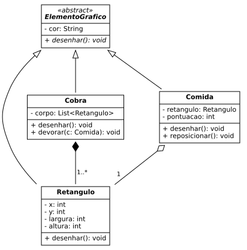

# 🧩 Lista 11 · Padrões de Projeto: Chain of Responsibility e Strategy

Quatro miniprojetos que aplicam herança, polimorfismo e padrões de projeto para que o código aceite novos tipos com o mínimo de alterações.

## Conteúdo

| Pasta | Projeto | Padrão / foco |
|---|---|---|
| [`questao-1-2-exercitos`](questao-1-2-exercitos) | ⚔️ **Batalha dos Exércitos**: compra de unidades e batalhas no estilo pedra-papel-tesoura | Classe abstrata + polimorfismo |
| [`questao-3-home-theater`](questao-3-home-theater) | 🎬 **Home Theater**: o "modo filme" percorre uma cadeia de aparelhos | **Chain of Responsibility** |
| [`questao-4-pookemon`](questao-4-pookemon) | 🌿 **POOkemon**: golpes que podem ser trocados durante o jogo | **Strategy** |
| [`questao-5-snake`](questao-5-snake) | 🐍 **Snake**: diagrama de classes UML | Generalização, composição e agregação |

## Classes

**Batalha dos Exércitos**

| Classe | Responsabilidade |
|---|---|
| `Unidade` | Superclasse abstrata. Guarda o tipo e declara `ganhaQuandoAtacadoPor(Unidade)`. |
| `Catapulta`, `Cavalaria`, `Infantaria` | Cada uma define de quem ganha: catapulta vence infantaria, cavalaria vence catapulta e infantaria vence cavalaria. |
| `Jogador` | Nome, dinheiro (começa com R$ 1200) e exército. Compra unidades por R$ 100. |
| `Jogo` | Fase de compras dos dois jogadores e batalhas aleatórias até um exército acabar. |

**Home Theater**

| Classe | Responsabilidade |
|---|---|
| `Aparelho` | Elo abstrato da cadeia. Executa o próprio modo filme e repassa o pedido ao próximo aparelho. |
| `TV` / `Luz` / `Som` | Ligar / apagar / mutar e subir o volume até 30. |
| `HomeTheater` | Recebe o primeiro aparelho da cadeia e dispara `ligarModoFilme()`. |
| `Programa` | Monta a cadeia TV → Luz → Som e ativa o modo filme. |

**POOkemon**

| Classe | Responsabilidade |
|---|---|
| `Ataque` | Interface da estratégia de ataque. |
| `SemAtaque` | Estratégia vazia, usada nos golpes ainda não aprendidos. |
| `Corte`, `FolhaNavalha`, `Terremoto` | Golpes concretos. |
| `Pokemon` | Nome, tipo, nível e quatro golpes que podem ser trocados pelos setters. |

**Snake**



## Conceitos praticados

Classes e métodos abstratos · herança e polimorfismo · `instanceof` · interfaces · `List` / `ArrayList` · encapsulamento · **Chain of Responsibility** · **Strategy** · UML

## Executar

JDK 11 ou superior. Cada pasta é compilada separadamente:

```bash
cd questao-1-2-exercitos && javac *.java && java Jogo        # jogo interativo
cd ../questao-3-home-theater && javac *.java && java Programa
cd ../questao-4-pookemon && javac *.java                    # só classes, sem main

# Diagrama (requer Graphviz)
cd ../questao-5-snake && dot -Tpng diagrama-snake.dot -o diagrama-snake.png
```

## Notas

- **Exércitos:** a entrada não é validada (qualquer opção que não seja 1 ou 2 vira Infantaria, e texto encerra o programa). Além disso, `getExercito()` devolve a lista interna em vez de uma cópia.
- **Home Theater:** só a TV imprime algo, então Luz e Som mudam de estado sem mostrar nada. O código do enunciado tinha `private void acesa;` na `Luz`, que não compila, e foi trocado por `boolean`.
- **POOkemon:** não tem `main` e ainda não implementa a escolha de qual golpe substituir ao aprender o quinto.
- **Snake:** o diagrama foi feito em Graphviz, e não numa ferramenta CASE. A classe `Jogo` e os getters e setters foram omitidos para deixar o diagrama mais limpo.

**O que eu faria diferente:** validar a entrada com `switch`, devolver uma lista não modificável em `getExercito()` com um método `remover(Unidade)` no `Jogador`, e criar um `main` de demonstração para o POOkemon.
